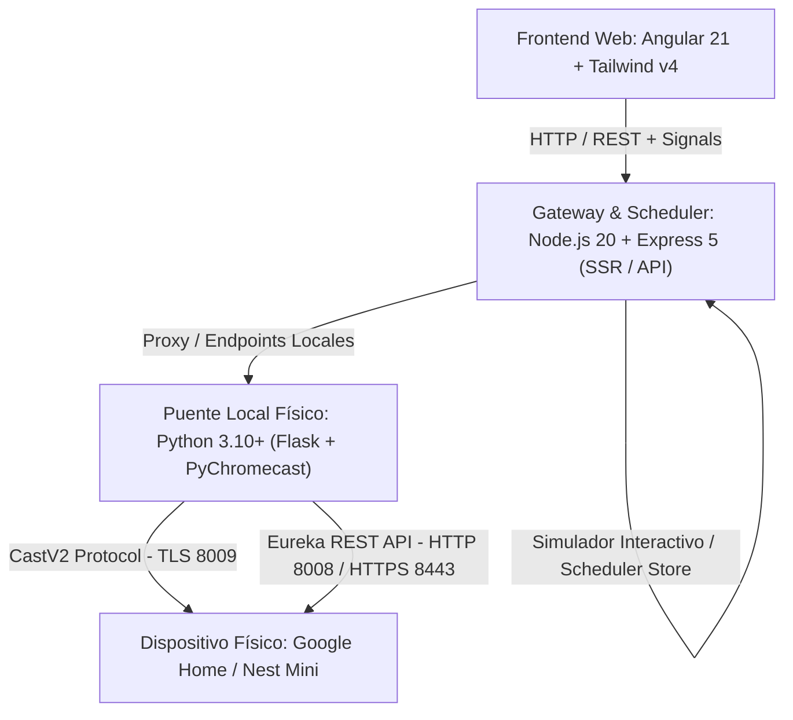

# NestCast Hub — Google Home Mini Controller & Local Automation Suite

<div align="center">


[](https://angular.dev/)
[](https://nodejs.org/)
[](https://expressjs.com/)
[](https://www.python.org/)
[](https://tailwindcss.com/)
[](LICENSE)

**Centro de control local, emparejamiento Wi-Fi y automatización para altavoces Google Home y Nest Mini sin depender de la nube.**

[Objetivo](#-objetivo-del-proyecto) •
[Stack Tecnológico](#-stack-completo) •
[Cómo Conecta con Google Home](#-funcionamiento-para-conectarse-con-google-home-mini) •
[Instalación](#-guía-de-instalación-y-despliegue) •
[Guía de Uso](#-guía-de-uso) •
[Estructura](#-estructura-del-proyecto)

</div>

---

## 🎯 Objetivo del Proyecto

**NestCast Hub** nace con el propósito de devolver el control total y la soberanía local de los dispositivos inteligentes **Google Home Mini y Nest Mini** a sus propietarios. 

Tradicionalmente, la configuración y el uso de estos altavoces requiere la aplicación móvil propietaria de Google Home, una cuenta vinculada a la nube de Google y acceso permanente a Internet. **NestCast Hub** elimina esa dependencia obligatoria al ofrecer:

1. **Gestión 100% Local**: Control de volumen, silenciamiento, reproducción de transmisiones de audio (Icecast, MP3, AAC, radios online) y texto a voz (TTS) directamente a través de la red local (LAN).
2. **Asistente de Emparejamiento Wi-Fi (Setup Wizard)**: Capacidad para aprovisionar y conectar a la red Wi-Fi altavoces nuevos o reseteados de fábrica mediante la API local no oficial (*Eureka API*) con cifrado criptográfico RSA PKCS#1 v1.5, sin necesidad de teléfono ni app propietaria.
3. **Escaneo de Subred Concurrente Ultra Rápido**: Barrido paralelo de red en ~1.5 segundos que sortea los bloqueos habituales de tráfico mDNS/multicast causados por routers domésticos entre bandas de 2.4 GHz y 5 GHz.
4. **Identificación Acústica ("Ping Chime")**: Envío de un tono auditivo de verificación para identificar físicamente qué altavoz específico se está gestionando en hogares u oficinas con múltiples bocinas.
5. **Motor de Automatización y Scheduler Local**: Programación de rutinas horarias y temporizadores de cuenta atrás persistentes (incluso tras reinicios del servidor), con soporte de ventana **No Molestar (DND)** y registro de auditoría de errores.
6. **Arquitectura Híbrida con Simulador Interactivo**: Permite desarrollar, probar e interactuar con toda la suite en cualquier navegador sin necesidad de hardware físico, enlazándose de forma transparente al puente físico cuando hay bocinas reales en la red.

---

## 🛠 Stack Completo

NestCast Hub está estructurado en una arquitectura desacoplada de alto rendimiento compuesta por tres niveles:



### 1. Frontend (Web App & UI)
* **Framework**: [Angular 21](https://angular.dev/) utilizando arquitectura reactiva basada en **Signals**, componentes *Standalone*, e inyección moderna.
* **Server-Side Rendering (SSR)**: Implementado con `@angular/ssr` y `@angular/platform-server` para una carga instantánea y optimización SEO.
* **Diseño y Estilos**: [Tailwind CSS v4](https://tailwindcss.com/) con `@tailwindcss/postcss`, con paleta de colores de diseño premium y sistema de **Tema Claro / Oscuro** persistente y sincronizado a nivel de `:root`, variables CSS y `color-scheme`.
* **Animaciones e Interacción**: [Motion](https://motion.dev/) (Framer Motion adaptado) para transiciones fluidas de paneles, modales, deslizadores y tarjetas.
* **Componentes UI e Iconografía**: Angular CDK y Google Material Symbols.
* **Inteligencia Artificial**: Integración opcional con `@google/genai` (Google Gemini SDK) para generación contextual de mensajes de voz y programación asistida.

### 2. Backend Intermedio, SSR & Motor de Scheduler (Node.js & Express)
* **Servidor**: Node.js >= 20.x con [Express 5](https://expressjs.com/).
* **Criptografía**: Módulo nativo `node:crypto` para la generación de pares de claves RSA de 2048 bits y cifrado de credenciales Wi-Fi (PKCS#1 v1.5).
* **Motor de Automatización (`SchedulerEngine`)**:
  * Ejecución de rutinas recurrentes y temporizadores de cuenta atrás en segundo plano.
  * Precisión temporal con tolerancia máxima de ±30 segundos.
  * Lógica de ventana **No Molestar (DND)** configurable con políticas de descarte o encolado en buffer.
  * Reintentos automáticos (hasta 3 intentos) y almacenamiento persistente en `data/scheduler-db.json`.
* **Despachador de Altavoces (`SpeakerDispatcher`)**: Interfaz desacoplada capaz de enviar comandos tanto a altavoces simulados en memoria como a bocinas físicas reales.

### 3. Backend de Control de Hardware (Python Local Bridge)
* **Servidor**: Python 3.10+ con [Flask](https://flask.palletsprojects.com/).
* **Protocolo Cast**: [PyChromecast](https://github.com/home-assistant-libs/pychromecast), implementando comunicación TLS a través del puerto 8009 bajo la especificación de buffers binarios *CastV2*.
* **Cliente de Configuración Wi-Fi (`setup_api.py`)**: Implementación en Python de la API Eureka no oficial con cifrado asimétrico mediante la librería `cryptography`.
* **Escáner Concurrente**: Sondeo masivo de subredes utilizando `concurrent.futures.ThreadPoolExecutor` (64 hilos de ejecución paralela).
* **Síntesis de Voz (TTS) y Servidor Multimedia**: Generación de audio mediante síntesis en caché local (`tts_cache/`) y exposición HTTP directa para que el altavoz descargue y reproduzca el sonido.

---

## 📡 Funcionamiento para Conectarse con Google Home Mini

Los dispositivos Google Home / Nest Mini operan en la red local exponiendo dos interfaces de comunicación independientes:

```
┌─────────────────────────────────────────────────────────────────────────┐
│                        Google Home / Nest Mini                          │
│                                                                         │
│   Puerto 8008 / 8443 (HTTP/HTTPS)          Puerto 8009 (TLS / TCP)      │
│   ┌─────────────────────────────┐         ┌─────────────────────────┐   │
│   │     Eureka REST API         │         │     Protocolo CastV2    │   │
│   │  • /setup/eureka_info       │         │  • Sockets con Protobuf │   │
│   │  • /setup/scan_wifi         │         │  • Control de Volumen   │   │
│   │  • /setup/connect_wifi      │         │  • Reproducción Media   │   │
│   │  • Clave Pública RSA        │         │  • Default Media Recv   │   │
│   └─────────────────────────────┘         └─────────────────────────┘   │
└────────────────────────────────────▲───────────────────▲────────────────┘
                                     │                   │
                        Peticiones HTTP/S          Conexión CastV2
                                     │                   │
                     ┌───────────────┴───────────────────┴─────────┐
                     │          NestCast Hub Local Bridge          │
                     │          (app.py / setup_api.py)            │
                     └─────────────────────────────────────────────┘
```

### 1. Puerto 8008 (HTTP) y 8443 (HTTPS) — API Eureka
Es la interfaz REST local (no oficial pero documentada por la comunidad mediante *GHLocalApi*) presente en todos los dispositivos Chromecast y Google Home:
* **`/setup/eureka_info?options=detail`**: Proporciona el nombre del dispositivo, UUID, SSID actual, versión de firmware y, fundamentalmente, la **clave pública RSA** del altavoz.
* **`/setup/scan_wifi` & `/setup/scan_results`**: Ordena al chip Wi-Fi del altavoz realizar un rastreo de redes circundantes y devuelve la lista de SSIDs, fuerza de señal y tipo de cifrado.
* **`/setup/connect_wifi` & `/setup/save_wifi`**: Permite enviar el SSID de la red doméstica y la clave Wi-Fi **previamente cifrada con la clave pública RSA** del altavoz.

### 2. Puerto 8009 (TLS sobre TCP) — Protocolo CastV2
Es el canal utilizado durante el uso cotidiano del altavoz:
* Utiliza sockets cifrados con mensajes serializados en formato Protocol Buffers (*protobuf*).
* Permite conectarse al espacio de nombres de control de medios (`urn:x-cast:com.google.cast.media`) y al receptor por defecto (*Default Media Receiver*).
* A través de este puerto, **NestCast Hub** envía órdenes de ajuste de volumen (0-100%), silencio (*mute*), pausa, reanudación y carga de URLs de audio (MP3/AAC/OGG).

---

### Modos de Descubrimiento y Emparejamiento en NestCast Hub

#### Modo A: Altavoces ya Conectados a la Red Local (LAN)
1. **Detección Automática de Subred**: El sistema detecta la dirección IP de la máquina anfitriona (por ejemplo, `192.168.1.x` o `192.168.18.x`).
2. **Escaneo Concurrente Multihilo**: En lugar de depender de mDNS (que falla frecuentemente si el PC está en cable Ethernet o en la banda de 5 GHz y el altavoz en 2.4 GHz), NestCast Hub lanza 64 hilos concurrentes que comprueban los puertos 8008 y 8009 en las 254 direcciones posibles de la subred en **menos de 2 segundos**.
3. **Identificación Acústica ("Hacer Sonar / Ping")**: Al pulsar el botón *Ping*, el hub ordena al altavoz reproducir un tono suave (`beep_short.ogg`), permitiendo al usuario saber con certeza qué bocina física tiene enfrente.
4. **Vinculación Directa en 1 Clic**: El dispositivo se añade a la lista de dispositivos activos y su IP queda memorizada reactivamente en `localStorage`.

#### Modo B: Dispositivo Nuevo o Reseteado de Fábrica (Modo Hotspot)
1. **Restablecimiento**: El usuario mantiene presionado el botón de reset del Google Home Mini (~15 segundos) hasta escuchar el aviso sonoro.
2. **Punto de Acceso Temporal**: El altavoz crea una red Wi-Fi abierta provisional (con formato `GoogleHomeXXXX.o` o `NestMiniXXXX.o`).
3. **Conexión del PC al Hotspot**: El PC o portátil se conecta a esa red Wi-Fi. El altavoz siempre responde en la dirección fija `192.168.255.249`.
4. **Lectura de Clave Pública**: NestCast Hub lee `/setup/eureka_info` y extrae la clave pública RSA del dispositivo.
5. **Escaneo de Redes Wi-Fi**: El altavoz escanea las redes Wi-Fi de la casa y devuelve las señales disponibles.
6. **Cifrado Asimétrico y Envío**: La contraseña de la red Wi-Fi elegida se cifra con **RSA PKCS#1 v1.5** utilizando la clave pública obtenida. Se envían los datos a `/setup/connect_wifi`.
7. **Migración a la Red Doméstica**: El altavoz apaga su punto de acceso, se une al router de la casa y NestCast Hub lo detecta automáticamente en la red local.

---

## 🚀 Guía de Instalación y Despliegue

### Requisitos Previos
* **Node.js**: Versión `20.x` o superior ([Descargar Node.js](https://nodejs.org/)).
* **Python**: Versión `3.10` o superior ([Descargar Python](https://www.python.org/)).
* **Red Wi-Fi**: El equipo que ejecute NestCast Hub debe estar conectado a la **misma red Wi-Fi/LAN** que el Google Home Mini.

---

### Paso 1: Clonar el Repositorio
```bash
git clone https://github.com/mchusantecnosys/nestcast-hub.git
cd nestcast-hub
```

### Paso 2: Configurar Variables de Entorno
Copia el archivo de ejemplo `.env.example` a `.env`:
```bash
# En Windows (PowerShell)
Copy-Item .env.example .env

# En Linux / macOS
cp .env.example .env
```
*(Opcional)* Si deseas usar funciones de inteligencia artificial para redacción de anuncios por voz, añade tu API key de Gemini en `GEMINI_API_KEY`.

---

### Paso 3: Instalar Dependencias del Frontend y Servidor Node.js
```bash
npm install
```

---

### Paso 4: Instalar Dependencias del Backend Python
Se recomienda el uso de un entorno virtual de Python:

```bash
# Crear entorno virtual
python -m venv .venv

# Activar entorno virtual:
# En Windows (PowerShell):
.venv\Scripts\Activate.ps1
# En Linux / macOS:
source .venv/bin/activate

# Instalar dependencias requeridas
pip install -r requirements.txt
```

> **Contenido de `requirements.txt`:**
> * `Flask>=3.0.0`
> * `requests>=2.31.0`
> * `pychromecast>=14.0.0`
> * `cryptography>=42.0.0`
> * `urllib3>=2.0.0`

---

### Paso 5: Puesta en Marcha

Para una experiencia completa conectando con altavoces reales, ejecuta ambos servicios en terminales independientes:

#### Terminal 1 — Backend Python (Control de Hardware)
```bash
# Asegúrate de tener el entorno virtual activo
python app.py
```
*El servicio se iniciará escuchando en `http://localhost:5000`.*

#### Terminal 2 — Frontend Angular y Servidor SSR
```bash
npm run dev
```
*La interfaz web estará disponible de inmediato en **`http://localhost:3000`**.*

> **Nota para desarrollo o demostración sin altavoces:**  
> Si no cuentas con un Google Home Mini físico en este momento, puedes iniciar únicamente `npm run dev`. NestCast Hub incluye un **simulador interactivo completo** que emula todas las respuestas de hardware y permite probar la interfaz, el volumen, el reproductor y las rutinas.

---

## 💻 Guía de Uso

Una vez abierta la aplicación en `http://localhost:3000`, dispondrás de tres áreas principales:

```
┌────────────────────────────────────────────────────────────────────────┐
│  NESTCAST HUB                           [Modo Oscuro] [Estado: Online] │
├────────────────────────┬───────────────────────────────────────────────┤
│  DISPOSITIVOS          │  PANEL PRINCIPAL                              │
│  ────────────          │  ────────────────                             │
│  • Sala Principal      │  [▶ Reproduciendo: SomaFM Groove Salad]       │
│  • Dormitorio (Activo) │  [──●────────────] Volumen: 65%               │
│  • + Vincular Altavoz  │                                               │
│                        │  [📻 Presets Rápidos] [🗣️ Texto a Voz (TTS)]  │
│                        │  [⏰ Rutinas y Alarmas] [⚙️ Configuración]    │
└────────────────────────┴───────────────────────────────────────────────┘
```

1. **Panel de Control Multimedia**:
   * Selección rápida del altavoz activo.
   * Deslizador de volumen fluido en tiempo real con protección anti-sobrescritura.
   * Controles de reproducción: *Play, Pausa, Stop y Cerrar App Cast*.
   * Presets de radio en directo (*SomaFM, Radio Swiss Jazz, Avisos acústicos*).
   * Generador de Texto a Voz (TTS) con historial y favoritos.

2. **Asistente de Emparejamiento y Escaneo**:
   * **Pestaña "En mi red local"**: Pulsa *"Escanear subred"* para detectar bocinas conectadas. Usa *"Ping"* para comprobar el sonido y pulsa *"Vincular"* para agregarlo.
   * **Pestaña "Nuevo altavoz / Hotspot"**: Conéctate a la Wi-Fi del altavoz nuevo, lee su clave RSA, elige tu red de casa, introduce la contraseña y pulsa *"Conectar Wi-Fi"*.

3. **Suite de Automatización y Scheduler**:
   * Creación de **Rutinas Programadas**: Elige hora, días de la semana, altavoz objetivo, nivel de volumen y acción (mensaje TTS o reproducción de stream).
   * **Temporizadores de Cuenta Atrás**: Programa avisos sonoros que se dispararán tras el tiempo indicado.
   * **Modo No Molestar (DND)**: Establece un rango horario nocturno para silenciar o encolar automáticamente los avisos sonoros.
   * **Bandeja de Notificaciones de Error**: Supervisa si algún altavoz no estaba disponible al momento de disparar una alarma.

---

## 📂 Estructura del Proyecto

```
nestcast-hub/
├── app.py                      # Backend Flask: CastV2, escaneo concurrente y streaming
├── setup_api.py                # Cliente de la API local Eureka (cifrado RSA Wi-Fi)
├── requirements.txt            # Dependencias de Python
├── package.json                # Dependencias y scripts de Node.js / Angular
├── angular.json                # Configuración de compilación Angular
├── data/
│   └── scheduler-db.json       # Persistencia de rutinas, DND y temporizadores
├── public/
│   └── favicon.ico             # Recursos estáticos
├── specs/                      # Especificaciones de diseño y arquitectura
│   ├── 002-scheduler-local/    # Especificación funcional del scheduler
│   ├── 003-voice-activation/   # Especificación de activación por voz
│   └── designs/                # Guías visuales y tokens de diseño
├── src/
│   ├── main.ts                 # Punto de entrada del cliente Angular
│   ├── main.server.ts          # Punto de entrada SSR
│   ├── server.ts               # Servidor Express, gateway de APIs y simulador
│   ├── styles.css              # Estilos globales y tokens CSS
│   ├── app/
│   │   ├── app.ts              # Componente principal
│   │   ├── app.html            # Plantilla principal del Hub
│   │   ├── components/         # Componentes modulares
│   │   │   ├── control-panel.ts    # Panel de reproducción y volumen
│   │   │   ├── automation-panel.ts # Gestión de rutinas y DND
│   │   │   ├── wifi-wizard.ts      # Asistente de emparejamiento Wi-Fi
│   │   │   ├── local-bridge.ts     # Monitor de conexión con app.py
│   │   │   └── day-timeline.ts     # Línea de tiempo diaria de rutinas
│   │   ├── models/             # Interfaces de datos y modelos TypeScript
│   │   └── services/           # Servicios reactivos
│   │       ├── cast-hub.ts         # Estado global de altavoces y reproducción
│   │       └── automation.service.ts # Lógica del cliente para el scheduler
│   ├── server/                 # Lógica de servidor Node.js
│   │   ├── scheduler-engine.ts # Motor del programador de tareas
│   │   └── scheduler-store.ts  # Capa de persistencia en disco
│   └── utils/                  # Funciones auxiliares puras y validaciones
└── tts_cache/                  # Archivos de audio generados para Text-to-Speech
```

---

## 🔒 Privacidad y Seguridad

* **Sin Envío de Datos a la Nube**: Las contraseñas de red Wi-Fi únicamente viajan cifradas con la clave pública del propio altavoz a través de la interfaz física de red.
* **Sin Credenciales Expuestas**: El proyecto incluye `.gitignore` configurado para evitar la filtración accidental de archivos `.env`, bases de datos locales o credenciales temporales.
* **Aislamiento en Red Local**: Diseñado para funcionar en redes protegidas con firewall doméstico o corporativo.

---

## 📄 Licencia

Este proyecto se distribuye bajo la licencia **MIT**. Consulta el archivo `LICENSE` para más información.
