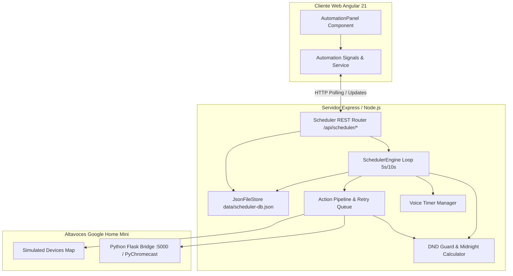
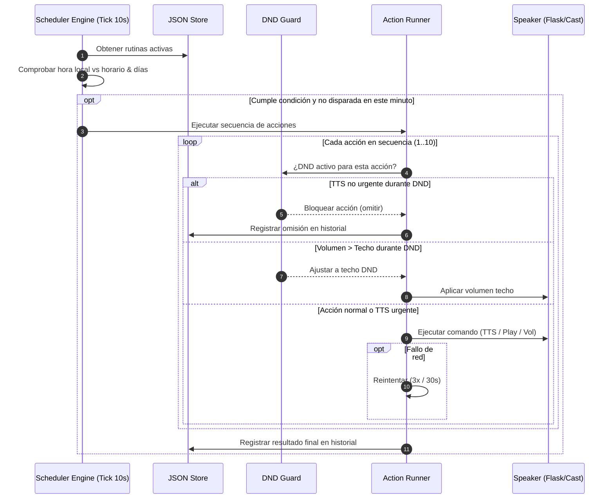

# Plan Técnico de Arquitectura e Implementación: Scheduler Local, Rutinas y Temporizadores (002-scheduler-local)

## 1. Resumen Ejecutivo y Objetivos

Este documento describe la arquitectura técnica, diseño de datos, especificación de APIs, motor de ejecución en backend, componentes frontend y fases de implementación para la funcionalidad de **Automatización, Rutinas y Horarios (Scheduler Local)** en NestCast Hub.

### Objetivos Clave
- **Autonomía del servidor:** El programador se ejecuta en el proceso servidor Express/Node.js; las rutinas y temporizadores se disparan puntualmente sin depender de que el navegador web esté abierto.
- **Persistencia atómica:** Rutinas, configuración DND, temporizadores activos, historial de ejecuciones y notificaciones se almacenan en disco (`data/scheduler-db.json`) y sobreviven a reinicios.
- **Enfoque en fiabilidad:** Reintentos automáticos (3 intentos cada 30 segundos) ante fallos de conectividad con los altavoces Google Home Mini y registro persistente de errores en el Hub.
- **Experiencia de usuario premium:** Interfaz reactiva basada en Angular Signals, con cuenta regresiva en vivo, constructor visual de secuencias de acciones, control intuitivo de No Molestar y avisos por voz limpios (solo TTS sin beeps).

---

## 2. Arquitectura del Sistema

El sistema se estructura en capas desacopladas que interactúan con el hardware real (o simulado) a través del puente local existente.



### Flujo de Ejecución de Rutinas



---

## 3. Modelo de Datos y Esquemas JSON

El almacenamiento persistente residirá en `data/scheduler-db.json`.

```typescript
// src/app/models/scheduler.models.ts

export type DayOfWeek = 'mon' | 'tue' | 'wed' | 'thu' | 'fri' | 'sat' | 'sun';

export type ActionType = 'tts' | 'play_url' | 'set_volume' | 'mute' | 'media_control';

export interface RoutineAction {
  id: string;
  type: ActionType;
  // Parámetros según tipo
  text?: string;                // Para 'tts'
  lang?: 'es' | 'en' | 'pt';    // Para 'tts'
  urgent?: boolean;             // Para 'tts' (salta DND)
  url?: string;                 // Para 'play_url'
  title?: string;               // Para 'play_url'
  volume?: number;              // Para 'set_volume' (0-100)
  muted?: boolean;              // Para 'mute'
  mediaAction?: 'pause' | 'stop'; // Para 'media_control'
}

export interface Routine {
  id: string;
  name: string;
  enabled: boolean;
  time: string;                 // "HH:mm" en formato 24h
  days: DayOfWeek[];            // Días activos (ej. ['mon', 'tue', ...])
  targetDeviceIds: string[];    // IDs de altavoces o ['all'] para todos
  actions: RoutineAction[];     // Secuencia de 1 a 10 acciones
  createdAt: string;            // ISO timestamp
  updatedAt: string;            // ISO timestamp
  lastRunAt?: string;           // ISO timestamp
  lastRunStatus?: 'success' | 'partial' | 'failed';
  nextRunAt?: string;           // ISO timestamp calculado
}

export interface DndConfig {
  enabled: boolean;
  startTime: string;            // "HH:mm" (ej. "21:00")
  endTime: string;              // "HH:mm" (ej. "07:00")
  maxVolume: number;            // Techo de volumen (default 25)
}

export interface ActiveTimer {
  id: string;
  label: string;                // Mensaje descriptivo (ej. "Blanqueamiento Consultorio 1")
  targetDeviceId: string;       // ID de altavoz destino
  durationMinutes: number;      // Duración total en minutos (1-480)
  alertPoints: number[];        // Minutos restantes para avisos (ej. [5, 1])
  startedAt: string;            // ISO timestamp
  endsAt: string;               // ISO timestamp
  alertsFired: number[];        // Minutos de alertas ya emitidas
}

export interface ExecutionLogEntry {
  id: string;
  routineId: string;
  routineName: string;
  executedAt: string;           // ISO timestamp
  status: 'success' | 'partial' | 'failed';
  details: string;              // Resumen de acciones ejecutadas / omitidas
  error?: string;
}

export interface ErrorNotification {
  id: string;
  title: string;
  message: string;
  sourceType: 'routine' | 'timer';
  sourceId: string;
  targetDeviceId?: string;
  timestamp: string;
  read: boolean;
}

export interface SchedulerDatabase {
  routines: Routine[];
  dnd: DndConfig;
  timers: ActiveTimer[];
  executionHistory: ExecutionLogEntry[];
  errorNotifications: ErrorNotification[];
}
```

---

## 4. Diseño de la API REST (`/api/scheduler/...`)

Todas las rutas se integran en el servidor Express existente (`src/server.ts`).

| Método | Endpoint | Descripción | Body / Parámetros |
|---|---|---|---|
| `GET` | `/api/scheduler/overview` | Resumen general: rutinas, estado DND, timers activos, conteo de errores sin leer | - |
| `GET` | `/api/scheduler/routines` | Lista completa de rutinas ordenadas por próximo disparo | - |
| `POST` | `/api/scheduler/routines` | Crear nueva rutina | `{ name, time, days, targetDeviceIds, actions }` |
| `PUT` | `/api/scheduler/routines/:id` | Actualizar rutina existente | Objeto rutina completo |
| `PATCH` | `/api/scheduler/routines/:id/toggle` | Pausar o reanudar rutina | `{ enabled: boolean }` |
| `DELETE` | `/api/scheduler/routines/:id` | Eliminar rutina permanentemente | - |
| `GET` | `/api/scheduler/routines/history` | Historial completo de ejecuciones | - |
| `DELETE` | `/api/scheduler/routines/history/:id` | Eliminar un registro específico del historial | - |
| `DELETE` | `/api/scheduler/routines/history` | Vaciar todo el historial de ejecuciones | - |
| `GET` | `/api/scheduler/dnd` | Obtener configuración DND actual | - |
| `PUT` | `/api/scheduler/dnd` | Actualizar configuración DND | `{ enabled, startTime, endTime, maxVolume }` |
| `GET` | `/api/scheduler/timers` | Lista de temporizadores activos en cuenta regresiva | - |
| `POST` | `/api/scheduler/timers` | Iniciar nuevo temporizador | `{ label, targetDeviceId, durationMinutes, alertPoints }` |
| `DELETE` | `/api/scheduler/timers/:id` | Cancelar temporizador (se borra de memoria y disco) | - |
| `GET` | `/api/scheduler/notifications` | Lista de notificaciones de error | - |
| `PATCH` | `/api/scheduler/notifications/:id/read` | Marcar notificación como leída | - |
| `DELETE` | `/api/scheduler/notifications/:id` | Descartar notificación | - |
| `DELETE` | `/api/scheduler/notifications` | Descartar todas las notificaciones | - |

---

## 5. Motor del Scheduler (Backend Engine)

### 5.1. Módulo de Lógica Pura (`src/utils/scheduler-logic.ts`)
Para garantizar pruebas unitarias completas e independientes del framework:
- `isDndActive(dnd: DndConfig, now: Date): boolean`: Maneja de forma precisa el cruce de medianoche (ej. 22:00 a 06:00).
- `calculateNextRun(time: string, days: DayOfWeek[], now: Date): Date | null`: Calcula el instante exacto del próximo disparo a partir de la hora local del servidor.
- `validateRoutine(routine: Partial<Routine>): string | null`: Valida 1-10 acciones, formato de hora, al menos un día y altavoz.
- `validateTimerInput(duration: number, alerts: number[]): string | null`: Valida que `duration >= 1`, `duration <= 480` y que cada alerta cumpla `0 < alert < duration`.
- `formatTimeRemaining(seconds: number): string`: Formatea a `mm:ss` o `hh:mm:ss`.

### 5.2. Gestor de Persistencia Atómica (`src/server/scheduler-store.ts`)
- Mantiene la base de datos en `data/scheduler-db.json`.
- Implementa escritura atómica con archivo temporal (`.tmp`) y renombrado (`fs.renameSync`) para evitar corrupción ante apagones o reinicios del proceso.
- En el arranque (`initSchedulerStore`), inicializa el archivo con datos por defecto si no existe.

### 5.3. Bucle de Evaluación (`SchedulerEngine`)
- **Frecuencia:** Se ejecuta cada **5 segundos** mediante `setInterval`.
- **Routines Tick:**
  - Evalúa cada rutina activa.
  - Verifica si `now` coincide con `routine.time` y el día actual, y si no fue ejecutada ya en el minuto corriente (`lastRunMinute !== currentMinute`).
  - Ejecuta la secuencia en segundo plano sin bloquear el loop.
- **Timers Tick:**
  - Evalúa cada temporizador activo: calcula `remainingSeconds = (timer.endsAt - now) / 1000`.
  - Si los minutos restantes coinciden con algún punto de `alertPoints` (y no ha sido alertado aún), despacha el TTS:
    - Formato de voz limpia: `"${timer.label}: faltan ${minutes} minutos"` (solo voz, sin pitidos).
    - Marca ese punto en `timer.alertsFired`.
  - Si `remainingSeconds <= 0`:
    - Despacha TTS de fin: `"${timer.label}: tiempo completado"`.
    - Remueve el temporizador de la lista persistida (desaparece de la interfaz).

### 5.4. Pipeline de Ejecución de Acciones y Reintentos
- **Encadenamiento ordenado:** Cada acción en la rutina espera la finalización o confirmación del despacho antes de iniciar la siguiente.
- **DND Guard:**
  - Si DND está activo:
    - Acción TTS no urgente $\rightarrow$ se omite y se registra como bloqueada.
    - Acción TTS urgente $\rightarrow$ se ejecuta respetando el techo de volumen.
    - Acción de volumen $\rightarrow$ se acota a `Math.min(requestedVolume, dnd.maxVolume)`.
- **Política de Reintentos:**
  - Ante error de conexión con el altavoz (código 500 / timeout), la acción se reintenta hasta **3 veces** con **30 segundos** de pausa entre intentos.
  - Si falla el tercer intento: se marca la rutina como fallida y se inserta un registro en `errorNotifications`.

---

## 6. Arquitectura del Frontend (Angular 21)

### 6.1. Integración en Navegación
- Se agrega el enlace **"Automatización"** en el header de navegación principal y en la barra móvil de `src/app/app.html`, junto con un badge indicador numérico en caso de que existan notificaciones de error sin leer.
- Se crea la señal `activeTab = signal<'control' | 'pair' | 'bridge' | 'automation'>('control')`.

### 6.2. Componente Principal: `AutomationPanelComponent` (`src/app/components/automation-panel.ts`)
Diseño moderno y modular con TailwindCSS, estructurado en secciones claras:
1. **Banner DND (Modo No Molestar):**
   - Switch de activación rápida.
   - Indicador de estado en tiempo real (Activo / En pausa).
   - Selector visual de franja horaria (Hora inicio y fin) y slider con techo de volumen permitido.
2. **Sección de Temporizadores Activos:**
   - Visualización de tarjetas de temporizadores con animación de pulso, barra de progreso y tiempo restante `mm:ss` en tiempo real.
   - Botón cancelar ("Detener") con eliminación inmediata de la vista.
   - Botón y modal para "Nuevo Temporizador": selector de altavoz, duración en minutos, chips interactivos de puntos de aviso (ej. 10m, 5m, 1m).
3. **Lista de Rutinas Programadas:**
   - Tarjetas de rutinas con próximo disparo en cuenta regresiva relativa (ej. "En 3 horas").
   - Chips de días de la semana (L, M, X, J, V, S, D).
   - Resumen visual de acciones encadenadas (iconos y descripciones breves).
   - Switch de pausar/reanudar y menú de acciones (Editar, Eliminar con confirmación modal).
4. **Modal Constructor de Rutinas:**
   - Nombre de rutina.
   - Selector de hora (24h) y días activos.
   - Selector de altavoz destino (individual o "Todos los altavoces").
   - Constructor dinámico de pasos (1 a 10 acciones) con capacidad de reordenar o eliminar pasos, y checkbox "Urgente" en pasos TTS.
5. **Historial de Ejecuciones y Centro de Notificaciones:**
   - Pestaña desplegable o lateral para revisar ejecuciones pasadas.
   - Botón individual de borrado y botón "Limpiar todo el historial".
   - Notificaciones de fallos destacados con opción de marcar como leídas o descartar.

### 6.3. Servicio Angular: `AutomationService` (`src/app/services/automation.service.ts`)
- Consume las APIs `/api/scheduler/*` utilizando `HttpClient` / `fetch`.
- Proporciona señales reactivas:
  - `routines`: `Signal<Routine[]>`
  - `activeTimers`: `Signal<ActiveTimer[]>`
  - `dndConfig`: `Signal<DndConfig>`
  - `history`: `Signal<ExecutionLogEntry[]>`
  - `unreadErrorsCount`: `Computed<number>`
  - `isDndCurrentlyActive`: `Computed<boolean>`
- Temporizador local en cliente (1 segundo) para refrescar el segundero de las cuentas regresivas visibles sin sobrecargar la red.

---

## 7. Plan de Implementación Paso a Paso

El desarrollo se ejecutará en **5 fases ordenadas**, verificando cada etapa con pruebas unitarias e integración:

### Fase 1: Lógica Pura y Modelos de Datos
- Crear `src/app/models/scheduler.models.ts`.
- Crear `src/utils/scheduler-logic.ts` con funciones puras (cálculo de días/horas, comprobación DND con cruce de medianoche, validaciones de rutina y timer).
- Crear tests unitarios en `src/utils/scheduler-logic.test.ts` con Vitest para validar todos los casos límite (CL-01 al CL-08).

### Fase 2: Almacenamiento y Motor Backend en Express
- Crear `src/server/scheduler-store.ts` para persistencia atómica en `data/scheduler-db.json`.
- Crear `src/server/scheduler-engine.ts` con el bucle de evaluación (rutinas + temporizadores + DND + reintentos + despacho TTS limpio).
- Extender `src/server.ts` montando las rutas `/api/scheduler/*` e iniciar el engine al levantar el servidor.
- Verificar funcionamiento de los endpoints mediante llamadas directas.

### Fase 3: Servicio de Frontend (`AutomationService`)
- Implementar `src/app/services/automation.service.ts` conectado a los endpoints `/api/scheduler/*`.
- Exponer señales reactivas, manejo de errores y actualización de timers en vivo.
- Integrar el servicio en `CastHubService` y en el flujo global de la aplicación.

### Fase 4: Componente de Interfaz (`AutomationPanelComponent`)
- Crear `src/app/components/automation-panel.ts` con diseño visual enriquecido (TailwindCSS, modo oscuro, responsive).
- Implementar sub-componentes / vistas:
  - Widget y configuración DND.
  - Widget de temporizadores activos y modal de nuevo timer.
  - Lista de rutinas con modal constructor de secuencias (1-10 acciones).
  - Panel de historial con borrado manual y centro de notificaciones de error.
- Añadir la pestaña "Automatización" al header y navegación móvil en `src/app/app.html` y `src/app/app.ts`.

### Fase 5: Pruebas de Integración y Validación de Criterios de Aceptación
- Ejecutar suite de pruebas con `npm test` (Vitest).
- Validar despacho de acciones con altavoz físico (`192.168.18.27`) y con altavoces simulados.
- Probar reinicio del servidor y verificar supervivencia de rutinas y temporizadores.
- Verificar que los temporizadores completados/cancelados desaparecen sin dejar rastro y que los avisos son solo voz.

---

## 8. Matriz de Riesgos y Mitigaciones

| Riesgo | Impacto | Mitigación |
|---|---|---|
| Altavoz apagado o desconectado al momento de disparar una rutina | Alto | El motor implementa 3 reintentos con intervalo de 30s. Si no responde, registra una notificación visible en el Hub (`RF-11`). |
| Pérdida de estado de timers si se reinicia el servidor | Medio | Los timers se persisten con `startedAt` y `endsAt`. Al reiniciar, el motor recalcula el tiempo restante y reanuda el timer si aún no ha expirado. |
| Altavoz desconfigurado o eliminado del Hub | Medio | Caso límite CL-01: La rutina se marca con advertencia visual "sin destino" y no se ejecuta hasta que se reasigne un altavoz válido. |
| Cruce de medianoche en franja DND (ej. 22:00 a 06:00) | Medio | La función pura `isDndActive` maneja explícitamente franjas donde `startTime > endTime` comparando minutos transcurridos desde medianoche. |
| Colisión de múltiples acciones o rutinas a la misma hora | Bajo | Las acciones se ejecutan secuencialmente con encadenamiento de promesas (`await`) y orden FIFO de creación. |
